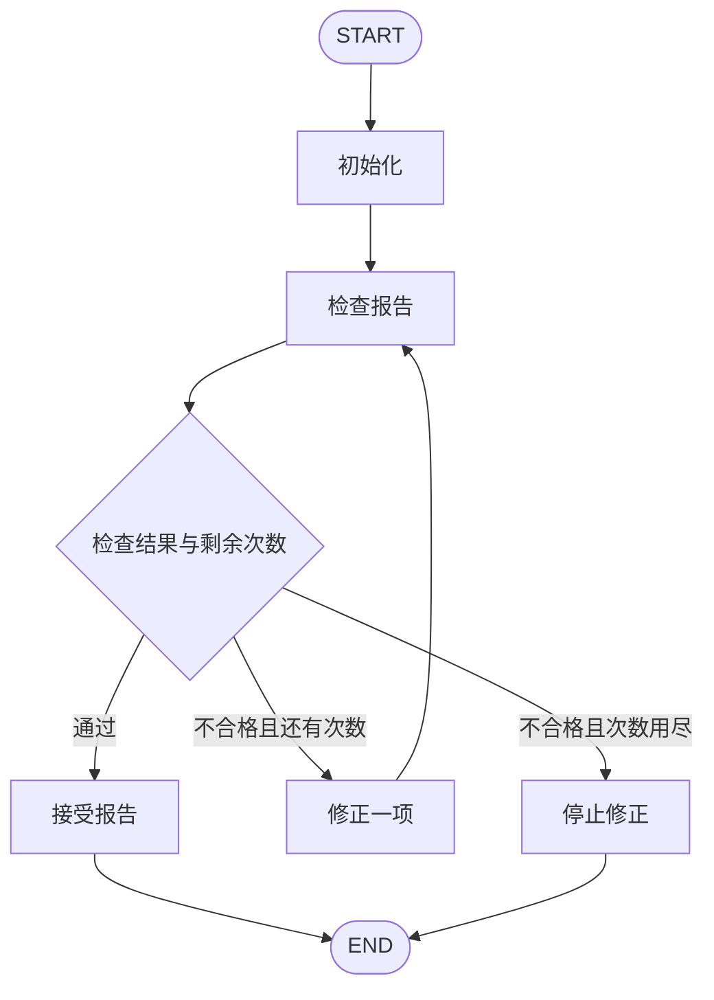

# LangGraph 学习之路：让工作流返工，也让它及时停下

用本地规则检查一份虚构报告：第一行应为 `# 出差资料整理`，末行应为 `来源：travel_policy.txt`。缺少内容时一次修正一项，修正后再次检查；通过或耗尽修正次数时结束。不调用模型，不需要密钥。

## 运行

使用 Python 3.12 和 uv，从仓库根目录进入本章：

```powershell
cd chapters/ch04_bounded_loops
uv sync --locked
uv run --locked python -m chapter_demo
```

默认草稿缺少标题和来源行。修正 2 次、检查 3 次后通过，退出码为 0。



菱形对应 `route_after_check` 路由函数；它不是单独注册的节点。检查节点只使用条件出边，修正节点通过普通边回到检查节点。

## 对照实验

```powershell
# 初稿已经合格：0 次修正，1 次检查
uv run --locked python -m chapter_demo --sample complete

# 只允许修正一次：仍缺来源，正常走停止分支，退出码 1
uv run --locked python -m chapter_demo --max-repairs 1

# 不允许修正：仍检查初稿，然后停止，退出码 1
uv run --locked python -m chapter_demo --max-repairs 0

# 模拟修正没有效果：仍在 2 次修正后停止，退出码 1
uv run --locked python -m chapter_demo --repair-mode unchanged

# 故意把图执行上限设得过小：框架中断，退出码 3
uv run --locked python -m chapter_demo --recursion-limit 3

# 展示最终状态，包含问题列表和日志
uv run --locked python -m chapter_demo --show-state
```

失败案例的报告、当前草稿与日志输出到 stderr，成功输出到 stdout。参数不合法时 argparse 返回 2。图执行超限只输出明确异常提示，不把中断当作业务完成，也不返回伪造的最终状态。

从章节外也可以运行：

```powershell
uv run --locked --project chapters/ch04_bounded_loops python -m chapter_demo
```

## 次数怎样计算

`max_repairs` 指允许执行修正节点的次数，范围为 0—10，默认 2。初稿不算修正。每次修正后仍会检查，因此修正两次后通过对应三次检查。路由先判断是否通过，再判断次数是否用尽，最后一次允许的修正也有机会被接受。

`issues` 默认覆盖，保存最近一次检查发现的问题；`logs` 使用 `Annotated[list[str], add]` 累积，每个节点只返回新增日志。循环内各节点返回局部更新，不直接修改输入状态。

`recursion_limit` 是 LangGraph 单次运行的 super-step 上限，通过 `graph.invoke(inputs, config={"recursion_limit": 32})` 配置，位于配置顶层。它与业务修正次数分开设置，默认 32 足够覆盖本章允许的 10 次修正。并行节点可以处于同一 super-step，所以不能把这个参数普遍理解为节点调用次数、修正次数或模型调用次数。上限过小时，有界流程也可能触发 `GraphRecursionError`。

## 文件与限制

- `state.py`：输入和状态字段；`nodes.py`：检查、单项修正和业务结束；`graph.py`：条件路由与回边；`__main__.py`：命令行入口。
- 包内 `draft.md` 与 `complete.md` 是自制报告，`travel_policy.txt` 是对应虚构资料。本章不自动生成摘要，正文是预先准备的。
- 检查仅比较规定的首行标题和末行来源标记，不校验事实、引用是否支持结论或正文质量。补上来源行只表示结构符合规则。
- `unchanged` 是刻意保留原文的故障实验，不代表模型调用。无网络请求、自动异常重试、检查点或跨调用记忆。

完整输出见 [预期输出](examples/expected-output.md)。可尝试增加“正文不得为空”规则，同时补上对应修正方式，观察预算不足时留下的问题。

## 验证与参考

```powershell
uv run --locked python -m unittest discover -s tests -v
```

核心依赖锁定 LangGraph 1.2.16。环境与覆盖情况见 [兼容记录](../../docs/compatibility.md)。

- [官方 Graph API：递归上限](https://docs.langchain.com/oss/python/langgraph/graph-api#recursion-limit)
- [官方 GRAPH_RECURSION_LIMIT 错误说明](https://docs.langchain.com/oss/python/langgraph/errors/GRAPH_RECURSION_LIMIT)
