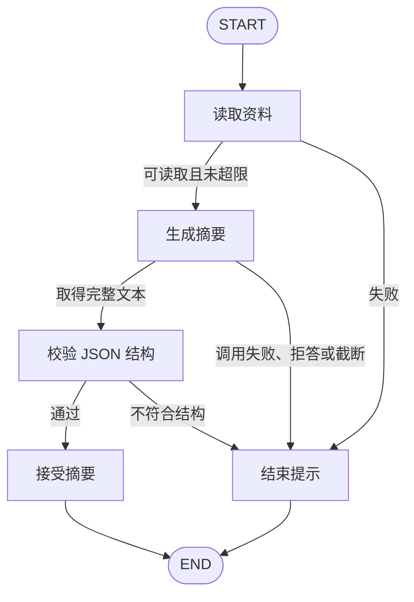

# LangGraph 学习之路：给文档摘要接上模型

读取短 TXT，把资料作为消息交给摘要节点，再用 Pydantic 校验 JSON 中的摘要和关键事项。默认 mock 使用固定响应，不调用模型；real 使用 DeepSeek 的 JSON Output。结构通过不代表事实正确。

## 安装与默认运行

使用 Python 3.12 和 uv。从仓库根目录运行：

```powershell
cd chapters/ch05_llm_summary
uv sync --locked
uv run --locked python -m chapter_demo
```

默认 mock 输出固定的出差规定摘要，明确显示“固定响应，未调用模型”。安装可能联网，安装完成后 mock 不需要密钥或模型服务。固定响应只适用于包内样例内容；不会为其他资料伪造同一份摘要。

## 实际调用 DeepSeek

在 DeepSeek 控制台准备可用密钥，选择支持 JSON Output 的模型。本章采用 `ChatDeepSeek` 和 `response_format={"type":"json_object"}`，不使用工具调用来生成摘要。

```powershell
Copy-Item .env.example .env
```

编辑 `.env`，填入自己的 `DEEPSEEK_API_KEY`；`DEEPSEEK_MODEL` 填实际模型名称。本章真实验证使用 `deepseek-flash`，其他名称以控制台和[官方模型列表](https://api-docs.deepseek.com/quick_start/pricing/)为准，不保证所有模型都兼容当前参数。

```powershell
uv run --locked --env-file .env python -m chapter_demo --mode real
```

`.env` 已被仓库忽略。程序不自动查找它；上面的 `--env-file` 是 uv 的参数，由 uv 加载到进程环境。也可以直接设置进程环境变量。mock 不读取密钥。

real 会将这份 TXT 内容发送到 DeepSeek，调用可能产生费用。每次运行至多请求一次，不自动重试或自动切回 mock。默认请求超时为 30 秒，`max_tokens=800`，关闭思考模式，响应必须是非空文本且不能标记为截断。输出长度参数和最终计费以服务端为准。

返回的是本次调用结果，措辞和关键事项数量可能变化；[输出记录](examples/expected-output.md)提供固定 mock 和一次真实响应作对照。

## 换自己的短资料

```powershell
uv run --locked --env-file .env python -m chapter_demo --mode real --input "D:/资料/访客须知.txt"
```

只支持 UTF-8 TXT，可带 BOM、中文空格路径和大小写扩展名。读取最多 64 KiB，换行统一为 LF、去除首尾空白后最多 4000 字符。空资料、无效编码或超限会在模型请求之前结束。4000 是 Python 字符数上限，包含内部换行，不是 token 计数，也不代表提供商的上下文窗口。本章不截断、不分块，不处理 DOCX/PDF。

从章节外运行时，章节位置和 `.env` 路径分别指定：

```powershell
uv run --locked --env-file chapters/ch05_llm_summary/.env --project chapters/ch05_llm_summary python -m chapter_demo --mode real
```

## 图怎样处理结果



- `prompts.py`：system 消息描述任务、JSON Schema 和形状示例；human 消息携带资料。它们只在调用时构造，本章不累积聊天历史。
- `model_adapter.py`：mock 和 DeepSeek 共用的调用接口。真实适配器通过 `ChatDeepSeek.bind(response_format=...)` 请求 JSON Output。JSON Schema 放在提示词里，并非服务端的原生 Schema 强约束。
- `schemas.py`：`summary` 为去除首尾空白后的 1—200 字符字符串，`key_points` 为 1—5 条，每条 1—100 字符。禁止额外字段，类型严格检查。
- `nodes.py`：只将完整原始文本交给 `DocumentSummary.model_validate_json`；坏 JSON 不会自动补全，缺字段不补默认值，失败原因保留字段路径和错误类型。

State、运行配置与 Context 各自承载的内容：

| 位置 | 本例内容 | 传入方式 |
| --- | --- | --- |
| State | 输入路径、资料文本、原始响应、校验结果、错误与日志 | `graph.invoke(inputs, ...)` |
| 运行配置 | 图执行上限；模型调用沿用框架的运行配置 | `config={"recursion_limit":16}` |
| Runtime Context | 本次运行使用的摘要客户端 | `context=SummaryContext(client=client)` |

图通过 `StateGraph(SummaryState, context_schema=SummaryContext)` 声明 Context，节点通过 `runtime.context.client` 取得客户端。密钥由 `Settings.from_env()` 读取并用于初始化客户端，不放入 State。Context 不是密钥保险箱；它也不负责替代环境变量或密钥管理。

## 故障实验

```powershell
uv run --locked python -m chapter_demo --mock-case missing-field
uv run --locked python -m chapter_demo --mock-case invalid-json
uv run --locked python -m chapter_demo --mock-case timeout
uv run --locked python -m chapter_demo --mock-case refusal
uv run --locked python -m chapter_demo --mock-case truncated
```

这些是刻意构造的模拟故障。缺字段示例得到 `key_points (missing)`；坏 JSON 得到 `JSON (json_invalid)`；其他情况在结构校验前结束。`truncated` 的文本本身是完整 JSON，也会因 `finish_reason=length` 被拒绝，以免把“恰好能解析”当作完整回答。

`--mock-case` 不能与 `--mode real` 组合。真实模式收到超时、连接错误或 HTTP 错误会报告对应原因，不自动更换模式。服务端原始错误正文不会写入公开结果。程序错误不统一吞成“模型失败”。

| 情况 | 输出位置 | 退出码 |
| --- | --- | --- |
| 摘要结构通过 | stdout | 0 |
| 输入、调用或校验失败 | stderr | 1 |
| 缺密钥/模型名，或命令参数错误 | stderr | 2 |

`--show-state` 可查看最终 State，其中包含资料与原始响应，请只在需要时使用。状态里不包含客户端和密钥。本章不落盘保存结果、检查点或日志，重新运行是一次新的任务；无需删除业务状态文件。删除章节 `.venv` 后可用 `uv sync --locked` 重建环境，`.env` 留在本机即可。

## 验证与适用范围

```powershell
uv run --locked python -m unittest discover -s tests -v
```

测试覆盖结构失败、输入限制、失败分支、消息与 Context、调用隔离，以及实际 DeepSeek 适配器通过本地 HTTP 替身发出的参数和错误处理。HTTP 替身不访问服务端，不作为真实模型能力证明。

真实模式验证过包内出差规定和一份不同内容的虚构访客须知，详细环境见[兼容记录](../../docs/compatibility.md)。样例结果只支持这些具体运行现象，不能代替质量评估。格式符合要求的错误事实仍可通过本章校验；引用是否支持结论、事实核对和提示注入防护不在当前校验能力内。

可尝试给结构增加 `open_questions` 字段，同时修改提示词和 mock 响应，观察少改一处会怎样失败。

参考：[DeepSeek JSON Output](https://api-docs.deepseek.com/guides/json_mode/)、[思考模式参数](https://api-docs.deepseek.com/guides/thinking_mode/)、[LangGraph Runtime Context](https://docs.langchain.com/oss/python/langgraph/graph-api#runtime-context)。
